

**软件工程 实验二：软件设计与建模**

**活动票务与报名系统（题目 5）**

| 课程名称 | 软件工程 |
|---|---|
| 学号 | 241220027 |
| 姓名 | 朱浩天 |
| 完成日期 | 2026-11-06 |

## 目录

一、活动票务与报名系统的主要功能

二、软件架构 UML 图

三、各个功能模块的 UI 界面及其功能描述

四、辅助工具（AI）的使用

五、版本信息

# 一、活动票务与报名系统的主要功能

本实验延续实验一的项目：题目 5——活动票务与报名系统。实验一完成了需求分析，产出了 24 条需求（功能需求 18 条、非功能需求 6 条），本实验在这份需求的基础上完成软件设计与建模。

系统面向四类角色：参与者（观众）、组织者、检票人员、平台管理员。主要功能如下：

**账号与权限**

- 用户以手机号 + 密码注册登录，注册后完成实名认证（姓名、身份证号），同一身份证仅允许绑定一个账号。
- 参与者与组织者注册时选择身份；检票人员与管理员账号由系统预置。
- 忘记密码可以自助重置；管理员可封禁违规账号，封禁后无法登录。

**演出发布与审核**

- 组织者提交演出申请，内容包括演出名称、类型（付费演出或讲座）、主演或主讲人，以及一个或多个场次，每个场次包含一个或多个票档（票档名称、价格、票数）。
- 平台管理员审核：通过则按申请者提供的上线时间上线；驳回须给出原因，组织者可修改后再次申请，不限次数。
- 演出上线后容量不可修改、票价不可修改、不可加量。

**查询与展示**

- 参与者可以按时间、地点、演出明星或主讲人、主题等条件筛选在售演出，查看场次余票状态（有余票可购、售罄可候补）和购票退票规则公示。

**购票、候补与退票**

- 参与者实名购票，每个账号在同一场次限购 1 张；下单后 3 分钟内通过站内模拟支付完成付款，出票时系统分配座位号并生成唯一票码。
- 票档售罄后可提交候补申请并预付全款，按先来后到排队；出现退票时自动递补队列首位，截止未递补全额原路退款。
- 参与者可自助退票，按距开演时间阶梯收取手续费：超过 7 天收 20%，3–7 天收 40%，不足 3 天不可退。

**演出变更与取消**

- 组织者修改演出时间或地点须重新审核；审核通过后通知全部已购票用户，用户可选按原价全额退款。

**检票与统计**

- 管理员在演出前约 3 小时开启签到窗口，检票人员输入观众票码并核对身份证号，通过则放行；演出结束未检票的订单转为已缺席。
- 按场次统计上座率、购票总人数、实际到场、候补人数、退票数；组织者可导出自己场次的观众名单（姓名、联系方式、座位号）。

**全程审计**

- 审核、支付、退票、核销、封禁、导出等关键操作全部记录操作者、时间、动作、对象和状态前后值，任何角色不可删改。

**明确不实现的内容**：不接入真实支付与短信（站内模拟支付、站内消息）；不做二维码与人脸识别（入场凭证为唯一票码字符串）；不做座位图选座（后台按票档统一分配）；不做公益免费票与票转让；不做黄牛自动检测（以实名限购和管理员手动封禁替代）。

# 二、软件架构 UML 图

本系统划分为 8 个模块。下面先给出模块划分和依赖关系，再用组件图、类图、用例图、活动图、时序图、状态图六张 UML 图说明设计。

## 模块划分

| 模块 | 职责 |
|---|---|
| M1 账号与权限 | 注册登录、实名认证、鉴权、封禁 |
| M2 活动发布与审核 | 演出申请受理、审核流转、上线 |
| M3 查询展示 | 演出查询、余票展示 |
| M4 交易（售票·候补·退款） | 限购校验、扣减余票、创建订单、模拟支付、出票、候补队列、递补、退票与退款 |
| M5 检票 | 票码核验、签到窗口控制 |
| M6 统计与导出 | 场次统计、名单导出 |
| M7 平台支撑 | 审计日志、站内通知 |

模块间的依赖关系：M3 从 M2、M4 只读查询；M5 检票、M6 统计与导出使用 M4 交易；M4 与 M2 把审计日志和站内通知写入 M7。其中 M4 被三个模块依赖，是全局枢纽，余票的扣减与回池只发生在 M4，这是防止超售的关键。

## 组件图

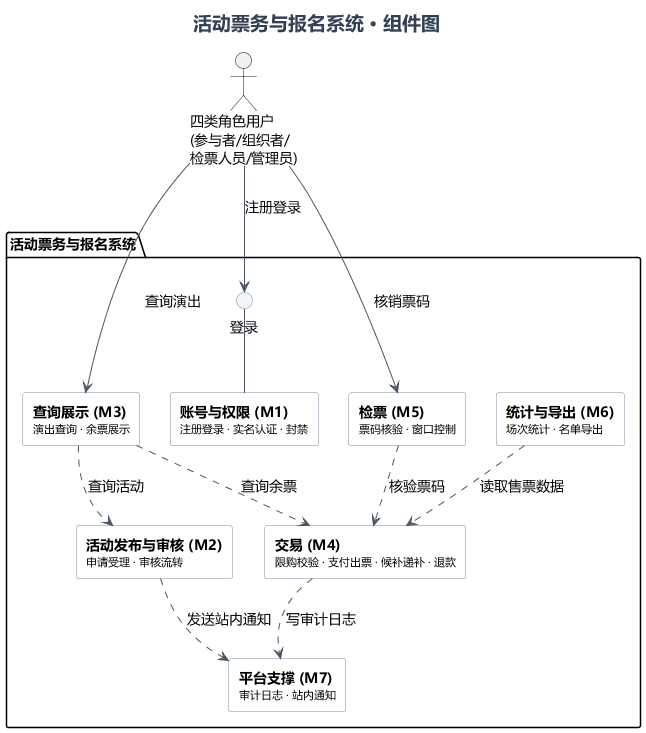

1. 查询展示(M3) 与 活动发布与审核(M2)、交易(M4)

- 逻辑关系：M3 只读，从 M2 查询活动信息、从 M4 查询余票。
- 设计原因：读写分离，查询压力不落到写入口上。

2. 检票(M5) 与 交易(M4)

- 逻辑关系：M5 核销前向 M4 核验票码，核验通过后由 M4 把订单转为已签到。
- 设计原因：核销涉及座位、票码和签到窗口，放在 M5 内独占校验逻辑。

3. 模拟支付并入交易(M4)

- 逻辑关系：下单、支付、退票退款在 M4 内闭环，组件图里只有 M1～M7 七个模块。
- 设计原因：本项目不接入真实支付，支付与订单事务（待支付、超时关闭、原路退回）不可分，独立成组件只会多一条依赖线。

4. 各模块 与 平台支撑(M7)

- 逻辑关系：各模块的关键操作都写入 M7 的审计日志，站内通知也由 M7 发出。
- 设计原因：审计、通知是横切能力，集中在一起避免每个模块各写一套。

## 类图

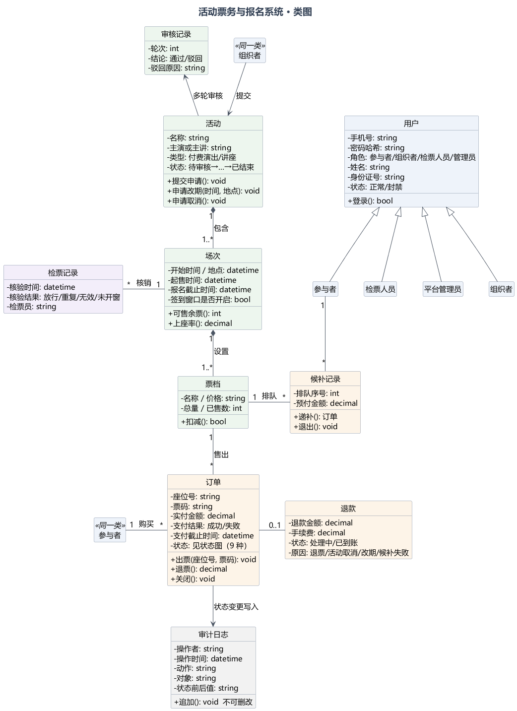

1. 用户与四种角色

- 逻辑关系：参与者、组织者、检票人员、平台管理员都是用户的子类，共享账号、实名与状态字段。
- 设计原因：登录、实名、封禁状态如果各写一遍要重复四份，泛化后权限判定集中在一处。

2. 组织者 与 活动

- 逻辑关系：一个组织者可以创建多个活动，活动必须属于一个组织者。
- 设计原因：审核驳回后的修改、出问题后的追责都依赖这条归属关系。

3. 活动 与 场次

- 逻辑关系：组合关系，一个活动包含一个或多个场次，活动取消场次一并失效。
- 设计原因：场次脱离活动没有意义，生命周期必须一致。

4. 场次 与 票档

- 逻辑关系：组合关系，每个场次包含一个或多个票档，座位分配和余票扣减都以票档为单位。
- 设计原因：票档是售票的最小单位，可售余票 = 票档总量 − 有效订单数。

5. 参与者 与 订单

- 逻辑关系：一个参与者可以有多条订单，同一场次限购一张，限购由售票过程校验。
- 设计原因：限购是业务规则而不是数据结构限制，所以用一对多关系。

6. 票档 与 订单

- 逻辑关系：订单从某个票档售出，余票不单独存字段，由有效订单推导。
- 设计原因：避免余票与实际订单不一致。

7. 订单 与 退款

- 逻辑关系：只有退票、活动取消、候补失败才有退款，一单最多一笔。
- 设计原因：用 0..1 表达"不是每单都退"，退款金额必须与实付减手续费一致。

8. 候补记录 与 订单

- 逻辑关系：候补记录先存在，递补成功才生成订单。
- 设计原因：两者不同时创建，用依赖而不是组合。

9. 审计日志

- 逻辑关系：审计日志独立存在，只记对象类型、对象 ID 和状态前后值。
- 设计原因：给每个类都连一条线会变成蜘蛛网，用 ID 引用同样可以追溯。

## 用例图

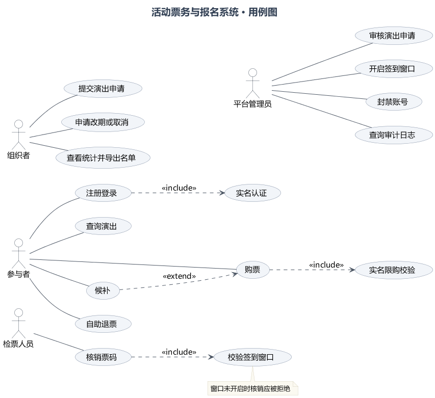

1. 参与者的用例

- 逻辑关系：注册登录包含实名认证；购票包含实名限购校验；售罄时购票扩展出候补。
- 设计原因：实名和限购是每次购票的必经步骤，用 include 表示；候补不是每次都发生，用 extend 表示。

2. 组织者的用例

- 逻辑关系：提交演出申请、申请改期或取消、查看统计并导出名单。
- 设计原因：覆盖组织者"发布—审核—统计"的完整业务闭环。

3. 检票人员的用例

- 逻辑关系：只有一个核销票码用例，包含校验签到窗口。
- 设计原因：需求明确检票人员无查询功能，图上不画就是设计约束的体现。

4. 平台管理员的用例

- 逻辑关系：审核演出申请、开启签到窗口、封禁账号、查询审计日志。
- 设计原因：管理员只做治理，不参与交易。

## 活动图

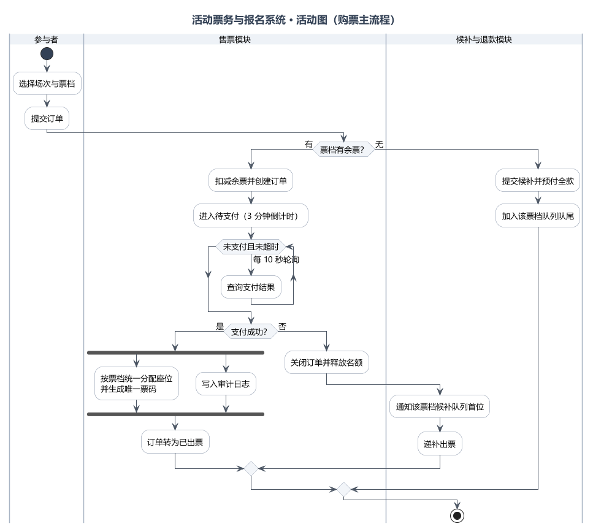

1. 余票判断

- 逻辑关系：提交订单后先判断票档是否有余票，有则扣减建单，无则转候补。
- 设计原因：把校验放在最前面，避免先建单后失败产生垃圾订单。

2. 支付轮询与超时

- 逻辑关系：订单进入待支付后轮询支付结果，3 分钟内支付成功即出票，超时自动关闭并释放名额。
- 设计原因：明确超时是循环的出口条件之一，而不是事后补救。

3. 售罄分支

- 逻辑关系：无余票时提交候补并预付全款，加入队尾。
- 设计原因：售罄不是报错，而是给出候补路径；预付是递补后能立即出票的前提。

4. 审计并行

- 逻辑关系：支付成功后生成票码与写审计日志两件事并行。
- 设计原因：出票和留痕互不依赖，日志失败不应阻塞出票。

## 时序图

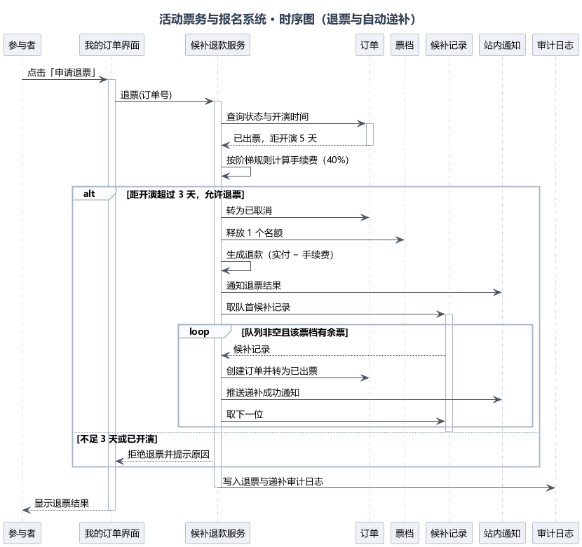

1. 参与者 与 我的订单界面

- 逻辑关系：参与者发起退票请求，界面收集订单与开演时间。
- 设计原因：退票入口统一在订单上，手续费计算需要开演时间。

2. 候补退款服务 与 订单、票档

- 逻辑关系：服务查询订单状态与开演时间，按阶梯规则计算手续费，退票后请求票档释放名额。
- 设计原因：手续费规则收在服务内部，金额错误只可能出在一个地方。

3. 释放名额 与 候补递补

- 逻辑关系：名额回池后取候补队列首位，循环递补直到队列空或名额用完。
- 设计原因：对应需求的自动递补，循环条件保证不超售。

4. 审计日志

- 逻辑关系：退票与递补全部落审计日志。
- 设计原因：一次退票可能触发多次递补，流程末尾统一写，避免中途失败留下半条记录。

## 状态图

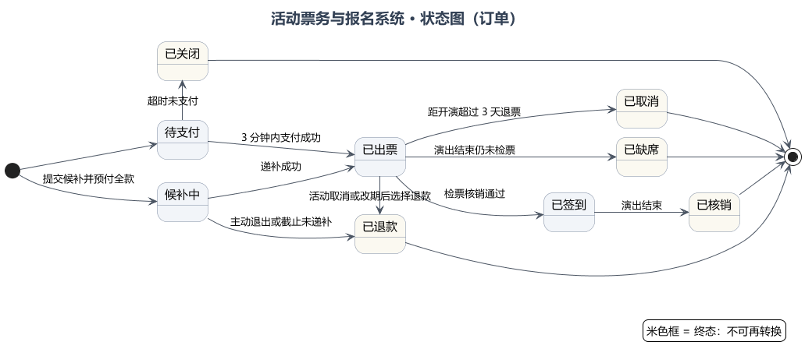

1. 两个初始状态

- 逻辑关系：正常下单进入待支付，票档售罄时提交候补并预付全款直接进入候补中。
- 设计原因：需求列的允许转换里没有"待支付→候补中"，所以用第二个初始转换表达候补入口。

2. 待支付 的两个出口

- 逻辑关系：3 分钟内支付成功转已出票，超时未支付转已关闭并回池。
- 设计原因：一对互斥出口，对应支付时限规则。

3. 已出票 的四个去向

- 逻辑关系：检票核销转已签到、演出结束未检票转已缺席、超过 3 天退票转已取消、活动取消或改期转已退款。
- 设计原因：覆盖"票卖出之后"的全部合法变化。

4. 五个终态

- 逻辑关系：已核销、已缺席、已取消、已关闭、已退款不可再转换。
- 设计原因：终态是状态机的边界，正文与图上一致地不画任何出边。

# 三、各个功能模块的 UI 界面及其功能描述

UI 界面使用 draw.io 绘制，源文件为 .drawio 格式，经 draw.io 导出服务渲染为 PNG。十屏遵循统一视觉规范：边框 #7C8AA0、页面底色 #EEF2F7、主文字 #334155，字体微软雅黑。按角色使用场景分为两类：界面 1–6 是参与者使用的网页门户，界面 7–10 是组织者、管理员、检票人员使用的工作台。

## 界面 1　登录 / 注册（未登录态）

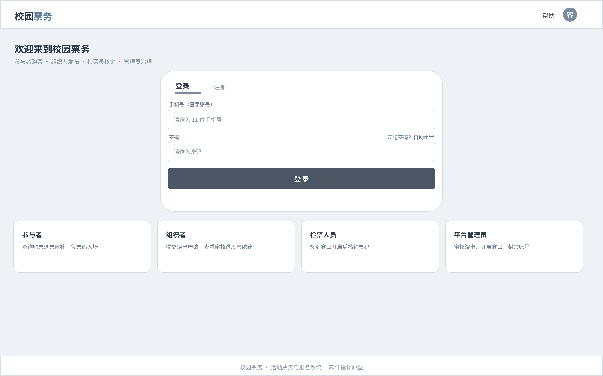

- 页面顶部是导航栏（logo 和帮助入口），中间是登录卡片，登录/注册两个页签切换。
- 登录需要手机号和密码，页面提供"忘记密码？自助重置"入口。
- 卡片下方是四张角色说明卡，说明参与者、组织者、检票人员、平台管理员各自能做什么；检票人员与管理员账号由系统预置，不开放注册。

## 界面 2　实名认证（已登录未实名）

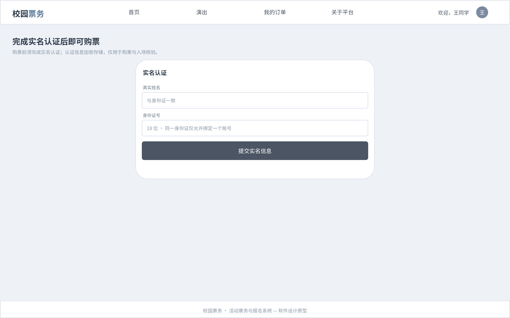

- 登录后如果还没有实名，页面提示"完成实名认证后即可购票"。
- 表单只需要真实姓名和身份证号，字段上注明同一身份证仅允许绑定一个账号。
- 认证信息加密存储，仅用于购票与入场核验。

## 界面 3　演出列表

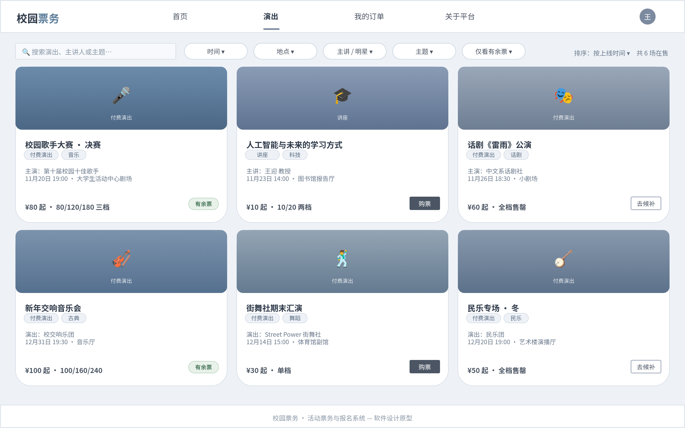

- 顶部导航栏提供搜索框和登录/注册按钮。
- 筛选行有时间、地点、主讲/明星、主题四个下拉，加一个"仅看有余票"快捷筛选，右侧是排序方式。
- 演出以卡片展示：渐变封面和类型标签、演出名称、主演、场次时间地点、票价区间；右下角是余票状态——绿色"有余票"、深色"购票"按钮、描边"去候补"按钮，分别对应可购、可购、售罄转候补三种状态。

## 界面 4　演出详情与购票

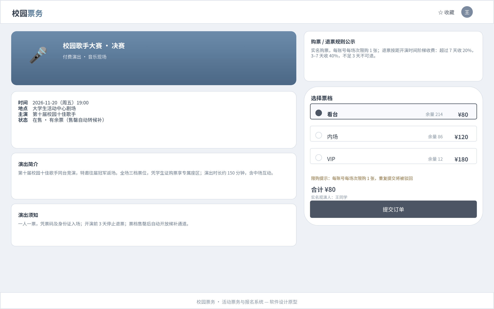

- 左侧是演出横幅、时间地点主演状态、演出简介和演出须知。
- 右侧上方是购票/退票规则公示：实名购票每账号每场次限购 1 张，退票阶梯收费。
- 票档选择为单选列表（看台 ¥80、内场 ¥120、VIP ¥180），每档显示余量；选中后下方合计金额随之变化，并与实名观演人一起进入订单。
- 提交订单后进入支付页面。

## 界面 5　支付与出票

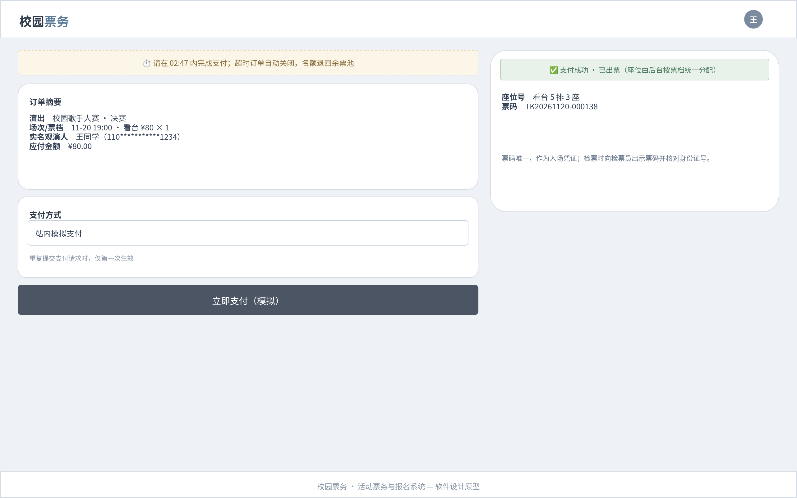

- 顶部是倒计时条：请在 02:47 内完成支付，超时订单自动关闭、名额退回余票池。
- 订单摘要列出演出、场次/票档、实名观演人和应付金额；支付方式为站内模拟支付，重复提交支付请求时仅第一次生效。
- 右侧是支付成功后的出票结果：座位号由后台按票档统一分配，票码唯一，作为入场凭证。

## 界面 6　我的订单

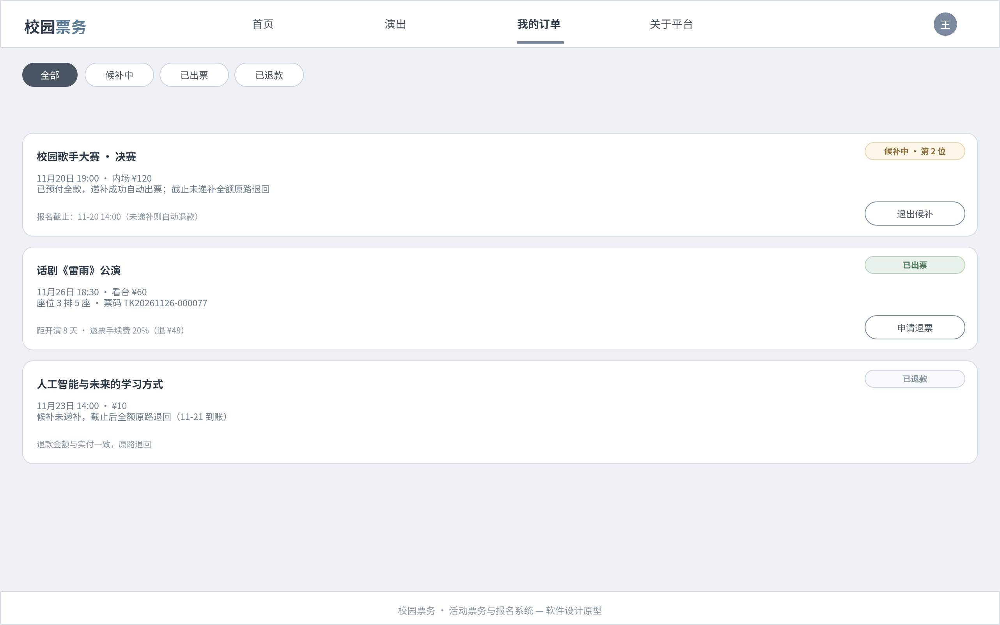

- 订单按状态筛选：全部、候补中、已出票、已退款。
- 候补中的订单显示预付全款、队列位次和报名截止时间，可以退出候补。
- 已出票的订单显示座位、票码和退票手续费试算（距开演 8 天收 20%，退 ¥48），可以申请退票。
- 已退款的订单显示候补未递补后全额原路退回的到账情况。

## 界面 7　组织者-演出管理

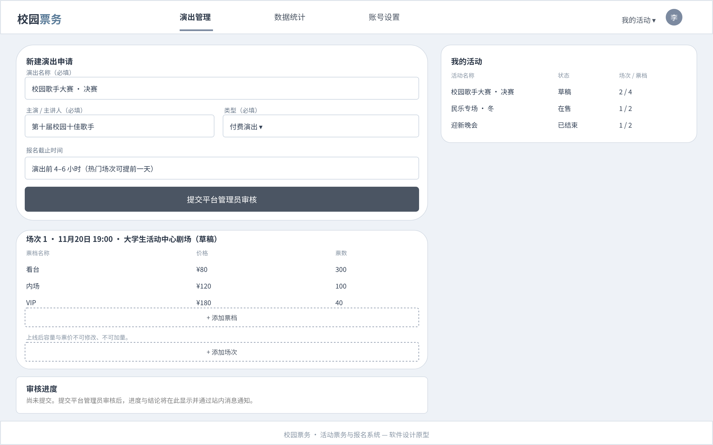

- 左上是新建演出申请表单：演出名称、主演/主讲人、类型（付费演出或讲座）、报名截止时间（演出前 4–6 小时，热门场次可提前一天）；必填信息缺失时无法提交，驳回后可修改再次申请。
- 左下是场次管理：场次 1 的时间、地点和票档表（票档名称/价格/票数），可以添加票档；页面注明上线后容量与票价不可修改、不可加量。
- 右侧是我的活动列表：草稿、在售、已结束三种状态和各自的场次/票档数。
- 底部是审核进度卡，提交后进度与结论会在这里显示并通过站内消息通知。

## 界面 8　管理员-审核

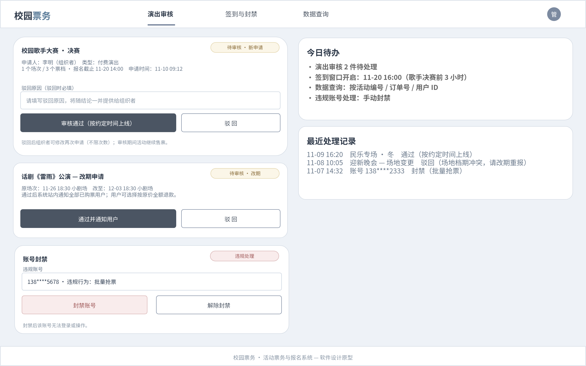

- 左侧是两件待办：新申请审核（申请人、场次票档摘要，审核通过即按约定时间上线，驳回原因必填）和改期申请（通过并通知全部已购票用户，用户可选按原价全额退款）。
- 左下是账号封禁卡：输入违规账号后可封禁或解封，封禁后账号无法登录。
- 右侧是今日待办（审核件数、签到窗口开启时间、数据查询方式）和最近处理记录（通过、驳回、封禁各一条）。

## 界面 9　检票工作台

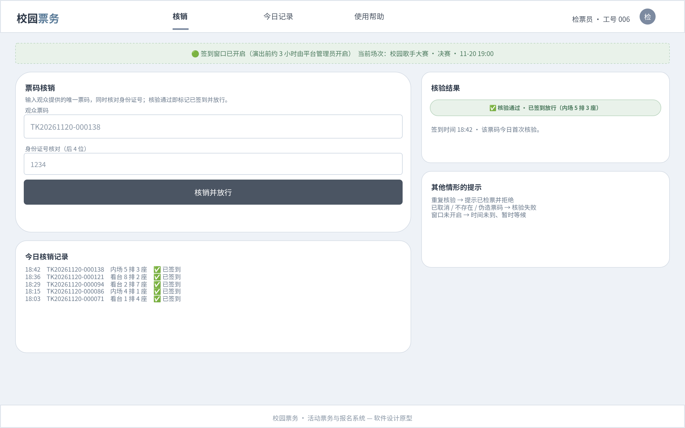

- 顶部状态条显示签到窗口已开启（演出前约 3 小时由管理员开启）和当前场次。
- 检票员输入观众票码并核对身份证号后 4 位，点击核销并放行。
- 右侧是核验结果（核验通过、座位号、签到时间）和其他情形的提示：重复核验提示已检票并拒绝，已取消或伪造票码核验失败，窗口未开启时提示等候。
- 下方是当日核销记录。

## 界面 10　统计与导出

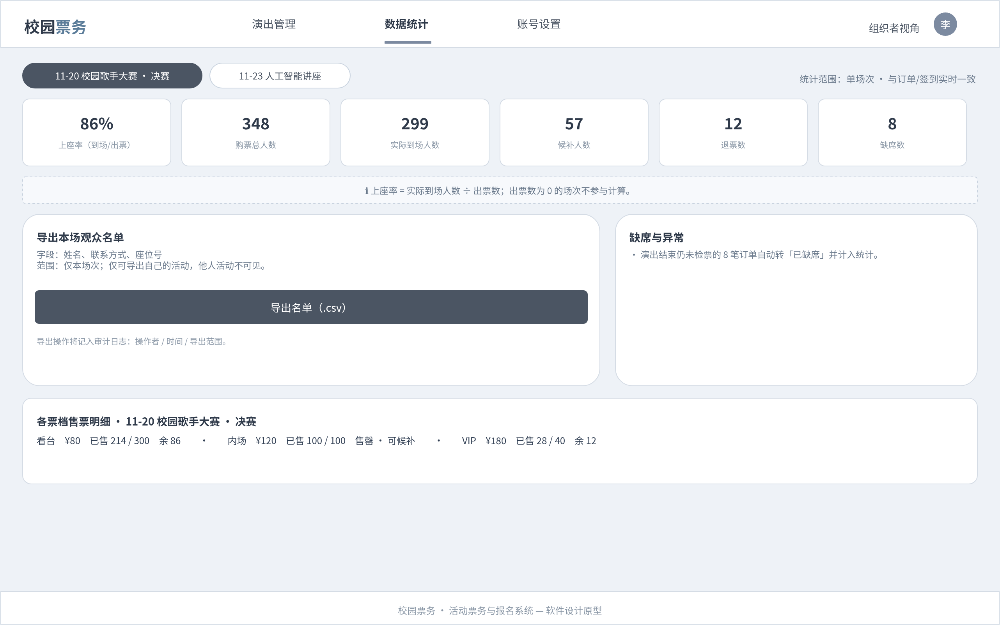

- 按场次筛选后展示六项统计：上座率 86%、购票总人数 348、实际到场 299、候补 57、退票 12、缺席 8。
- 统计口径：上座率 = 实际到场人数 ÷ 出票数，出票数为 0 的场次不参与计算。
- 导出本场观众名单，字段为姓名、联系方式、座位号（不含身份证号），仅限本场次、仅限自己的活动；导出操作会记入审计日志。
- 底部是各票档售票明细，与统计数字互相印证。

# 四、辅助工具（AI）的使用

本实验使用 ZCode（agent 形态的大模型助手，具备文件读写、多模态图像理解与命令执行能力）辅助完成设计。下面按使用场景记录，每条按使用场景、生成结果、优缺点分析、修改优化后的结果四段展开。

## 1. 模块划分初稿

- 使用场景：把实验一定稿的 24 条需求和题目基本要求交给 AI，要求产出模块划分、模块间依赖和逐条需求对齐表。
- 生成结果：7 个业务模块（M1 账号与权限、M2 活动发布与审核、M3 查询展示、M4 交易（售票·候补·退款）、M5 检票、M6 统计与导出、M7 平台支撑）和需求对齐表，即本报告第 2 部分的初稿。
- 优缺点分析：优点是覆盖完整、速度快，对齐表可以直接当追踪基线用；缺点是模块边界按工程直觉划分，个别职责归属需要人来判断，比如检票和售票都涉及订单数据，依赖方向是否正确必须对照需求才能确认。
- 修改优化后的结果：我逐条核对了 24 条需求，修正了职责描述和依赖方向，明确了"余票只有一个写入口（M4）"这条关键约束，形成定稿。

## 2. UML 图

- 使用场景：类图、组件图、用例图、活动图、时序图、状态图六张图的 PlantUML 初稿，以及此后的布局迭代。
- 生成结果：六张图的源码和渲染 PNG；类图做到 14 个类、零连线交叉，状态图是从左向右的主链布局。
- 优缺点分析：优点是语法零错误、迭代快，把看到的问题用文字描述给 AI 就能重新渲染，不用手工拖拽；缺点是布局引擎可控性有限，连线交叉、元素重叠需要多轮"我看图 → 描述问题 → AI 调整"才收敛，而且部分方向提示在 left to right 模式下会旋转 90°，有一次整版按错误方向排完后返工。
- 修改优化后的结果：类图经过十余轮迭代消除全部交叉；组件图按调用方向重新分层；用例图删掉系统边界框后重排；状态图改成横版主链布局。中间 AI 也出现过理解偏差（比如把方向提示当成了不生效的普通文字），都靠我指出后修正。

## 3. UI 界面

- 使用场景：十屏界面的 .drawio 源文件初稿生成，经 draw.io 官方导出服务渲染成 PNG，以及按我的意见逐屏修改。
- 生成结果：十屏源文件与渲染图，视觉规范全组统一，演示数据跨屏一致。
- 优缺点分析：优点是十屏风格统一、修改可以精确到坐标、产物直接就是交付格式；缺点是 draw.io 的 XML 是绝对坐标布局，AI 生成的文字和控件经常差几像素互相压线，先后出现标签贴框、长句出框、元素挂错节点不显示等问题；另外有一次 AI 把"站内模拟支付"画成了系统外的"外部系统"，混淆了项目边界。
- 修改优化后的结果：我用多模态视觉逐屏检查，配合 AI 修正了全部遮挡和出框；把"统计口径""已按隐私要求移除"这类需求文档语言从界面上清除；发现界面 1 在未登录态就放着实名认证表单（未登录不能实名），把它拆成了登录注册和实名认证两屏。最后我在 draw.io 里手动调整了几屏的排版并导出终稿。

## 4. 报告撰写

- 使用场景：本报告的素材整合与初稿起草。
- 生成结果：报告草稿，模块划分与 UML 两部分由既有文档改编，UI 和本章由工作记录整理。
- 优缺点分析：优点是素材定位快、格式统一；缺点是 AI 分不清哪些内容属于报告、哪些属于工作笔记，一开始把"统计口径"这类内部词汇直接写进了面向用户的界面说明里。
- 修改优化后的结果：按"报告给老师看、界面给用户看"的原则分开，报告里的需求引用保留，界面上的全部删除。

## 5. 辅助工具的优缺点分析

- 优点：
  - 结构化产出（表格、图、界面稿、对照表）的速度优势极大，让我可以把时间花在检查和取舍上。
  - 多模态视觉让"AI 画、我挑刺、AI 改"的循环收敛很快，不用来回截图描述。
  - 跨屏数据一致性这类能机械验证的问题，AI 可以自查修正。
- 缺点：
  - 对"正确"的判断依赖可检验的标准：需求编号、数据一致这类能比对的它能自查，取舍和优先级必须我来定。
  - 长文档的坐标级细节（界面布局、图形布局）容易压线和出框，每次改动都需要渲染后目检。
  - 会把工作语言（口径、范围、甲方确认）不自觉地带进面向用户的界面，需要站在"用户看到什么"的立场再过一遍。
  - 重新运行生成脚本会覆盖手工修改过的源文件，协作时必须约定修改方式，我已经为此损失过一版手改。

## 6. 两点思考

关于大模型如何辅助软件设计：在本实验里它承担的是"把需求翻译成结构化设计产物"的角色——模块划分、UML、界面稿、需求对照表。它的产出质量高度依赖输入的规范程度，实验一留下的结构化需求（编号、验收标准、来源）直接决定了模块划分和 UI 对照的质量；而设计对不对，仍然由人对照需求来裁决。合理的分工是 AI 负责产出候选和机械一致性检查，人负责需求解释、取舍和验收。

关于能否设计一套只做检查校对的工作流：本实验已经部分实现了这条流水线——AI 产出初稿，确定性检查（需求对照表核对、编号 grep、跨屏数据比对）自动做，人工做多模态目检和 draw.io 终检。在这条流水线上，人的角色从"画图"退到了"审图"，每轮修改只需要提出意见。它的边界也很清楚：能写成检查规则的问题（连线交叉、文字遮挡、编号引用、命名一致、跨屏数据一致）都可以交给自动化；而"这个设计是否合理""这个状态是否应该存在""这个功能要不要做"仍然需要人来判断——本实验中至少有三个问题（模拟支付被画成外部系统、界面 1 的登录态矛盾、审核卡缺少场次明细）是规则查不出来、靠人看出来的。

# 五、版本信息

- 仓库地址：https://github.com/haoyi-yizhan/RUANGONG_lab1（实验二延续使用同一仓库，工作目录 lab2/）
- 分支：main
- 实验一标签：lab1-ai-draft（1f20b402468a6d3dc25a2331a3a6740c07bda22e）、lab1-final（57b9246c650eaf6755b237077c3c5c78bf0388ef）
- 实验二关键提交：
  - 4558f5c　实验二任务书
  - 5e61055　AI 生成：模块划分初稿
  - 02beb03　AI 生成：类图初稿
  - 107cc70　UI 界面初稿（draw.io 源文件 + 渲染 PNG）
  - 其后为 UML 迭代、界面重编号、手动终检等提交，完整历史见仓库
- 文件位置：交付物/UML/（PlantUML 源码 + PNG，共 6 图）、交付物/UI界面/（.drawio 源文件 + 渲染 PNG，共 10 屏）
